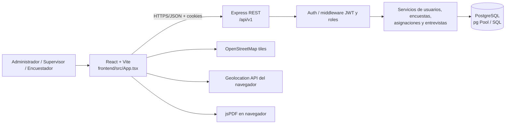

# 1. Arquitectura

## Componentes

| Componente | Implementación comprobada | Responsabilidad |
|---|---|---|
| Cliente web | React 19, TypeScript, Vite 8; `frontend/src/main.tsx`, `frontend/src/App.tsx` | Interfaz, formularios, estado local, llamadas HTTP, dashboards, mapas y PDFs. |
| API | Node.js, Express 4, TypeScript; `backend/src/server.ts`, `backend/src/app.ts` | HTTP, middleware, autorización, validación, coordinación de módulos. |
| Persistencia | PostgreSQL y `pg`; `backend/src/database/pool.ts` | Usuarios/roles, encuestas/versiones, comunidades/asignaciones, entrevistas/respuestas. |
| Autenticación | JWT en cookies HttpOnly y refresh token persistido como SHA-256 | Inicio/cierre, restauración y renovación de sesión. |
| Mapas | Leaflet / React Leaflet y mosaicos de OpenStreetMap | Visualizar entrevistas con coordenadas GPS; depende de red y de los mosaicos. |
| PDF | jsPDF y jspdf-autotable | Generar boleta en el navegador y permitir imprimir/descargar. |

No se encontró servicio externo de archivos, backend de almacenamiento, proveedor de identidad ni proceso en segundo plano implementado. La documentación raíz menciona despliegues posibles, pero no hay archivos de infraestructura para verificarlos.

## Diagrama

## Límites y dependencias

- Vite entrega el frontend y en desarrollo reenvía `/api` a `http://localhost:3001` (`frontend/vite.config.ts`).
- `backend/src/app.ts` crea Express, configura Helmet, CORS, parsers, cookies, Morgan, rate limit, health check y monta routers bajo `/api/${API_VERSION}`.
- `backend/src/server.ts` prueba PostgreSQL antes de aceptar tráfico; si falla, termina el proceso.
- Los routers llaman a controladores (cuando existen); estos validan y delegan en servicios; servicios realizan SQL mediante `database/pool.ts`.
- No hay ORM, repositorio separado ni modelos de clases; los esquemas de persistencia declarados son migraciones SQL.
- El frontend no usa React Router: `App` cambia una pestaña con el estado `activeTab`. Tampoco se encontró store global; usa hooks React locales.

Referencias: [`main.tsx`](../../frontend/src/main.tsx), [`App.tsx`](../../frontend/src/App.tsx), [`vite.config.ts`](../../frontend/vite.config.ts), [`app.ts`](../../backend/src/app.ts), [`server.ts`](../../backend/src/server.ts), [`pool.ts`](../../backend/src/database/pool.ts).
