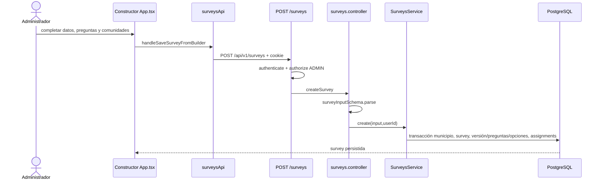
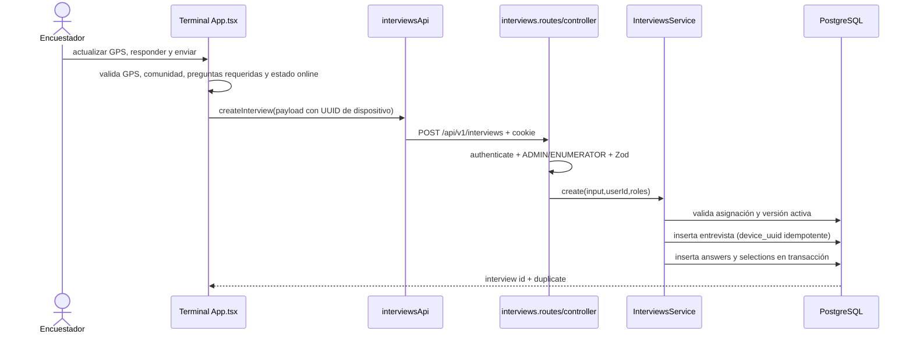

# 9. Flujos funcionales

## Inicio y restauración de sesión

```mermaid
sequenceDiagram
  actor U as Usuario
  participant UI as App.tsx / authApi
  participant API as auth.routes/controller
  participant S as AuthService
  participant DB as PostgreSQL
  U->>UI: alias/correo + contraseña
  UI->>API: POST /auth/login (JSON)
  API->>S: login(identifier,password)
  S->>DB: SELECT users, roles, enumerators
  S->>DB: comprobar bcrypt; crear refresh hash
  API-->>UI: usuario + cookies HttpOnly
  UI->>API: al recargar GET /auth/me
  API-->>UI: sesión o POST /auth/refresh y cookies rotadas
```

Login no persiste token en el body; `getCurrentSession` coalesce llamadas concurrentes para React StrictMode. Auth consulta PostgreSQL y refresca. Código: `authApi.ts`, `auth.controller.ts`, `auth.service.ts`.

## Crear encuesta y asignaciones iniciales



Editar crea una nueva versión de preguntas y actualiza/cancela asignaciones no retenidas. La encuesta se lista con join a departamento/municipio, versión vigente y asignaciones activas/pending.

## Reasignar/crear comunidad en estudio guardado

`Comunidades y Asignaciones` selecciona un registro de `listSurveys()`. Crear llama `POST /assignments/:surveyId`; editar/reasignar usa `PATCH /assignments/:surveyId/:communityId`. Backend exige ADMIN, valida Zod, realiza transacción y el cliente actualiza su estado solo tras éxito. Se requiere aplicar migración 013 para `survey_assignments.community_name`.

La tabla Estudios Guardados incluye archivados para ADMIN; el botón de reactivación llama `PATCH /surveys/:id/restore`. El servicio pone el estudio en estado `active` y rehabilita la asignación cancelada más reciente por comunidad en registros archivados con asignaciones canceladas. A partir de ahora, archivar conserva los estados de asignación y el estado del estudio bloquea el registro de entrevistas.

## Enviar entrevista



El servicio rechaza preguntas fuera de la versión, requeridas sin respuesta y usuarios sin asignación vigente. La UI no sincroniza offline: el modo offline visual impide el envío y no almacena cola.

## Dashboard y mapa

Al autenticar, efectos React llaman `listSurveys`, `listInterviews` (y `listUsers` para roles que lo requieren). Los datos se mantienen en memoria React. Dashboard agrupa respuestas retornadas en cliente; mapa filtra registros con lat/lng válidos y usa OSM para fondo. No se detectó endpoint agregado de estadísticas ni reporte backend.

## Usuario

Administrador envía formulario con alias, datos, rol y password a `POST /users`; UsersService hace bcrypt, transacción de user+role y perfil enumerator cuando aplica. Edición/desactivación/reactivación usan endpoints separados; desactivar conserva registro, deshabilita enumerator y revoca refresh tokens.

## Funcionalidades no confirmadas

Las tablas de sync y respondents no tienen flujo de escritura visible. No se confirma sincronización offline, exportación Excel, reports API, ni mantenedor CRUD de geografía/elecciones/candidatos/encuestadores.
